# KopiDanNyemil ☕

Aplikasi pemesanan kopi dan makanan ringan berbasis Android yang dibuat untuk memenuhi tugas Ujian Tengah Semester (UTS).

## Fitur Aplikasi

- Registrasi dan login pengguna.
- Halaman utama yang menampilkan daftar produk.
- Detail produk dan pengaturan jumlah pesanan.
- Pengisian alamat pengiriman.
- Konfirmasi pesanan.
- Riwayat pesanan.
- Profil pengguna dan logout.

## Teknologi

- Android Studio
- Kotlin
- XML
- SharedPreferences

## Produk

- Cappuccino
- Cafe Latte
- Americano
- Croissant
- Roti Bakar

## Pengembang

Nadhifa Zahra Syaifi

## Repository

https://github.com/nzhrasyaifi-glitch/KopiDanNyemil

## Cara Menjalankan Aplikasi

1. Clone repository KopiDanNyemil dari GitHub.
2. Buka project menggunakan Android Studio.
3. Tunggu hingga proses Gradle Sync selesai.
4. Hubungkan perangkat Android atau jalankan Android Emulator.
5. Klik tombol Run untuk menjalankan aplikasi.

## Screenshot Tampilan

Berikut adalah dokumentasi tampilan aplikasi KopiDanNyemil:

  ### Splash/Welcome
  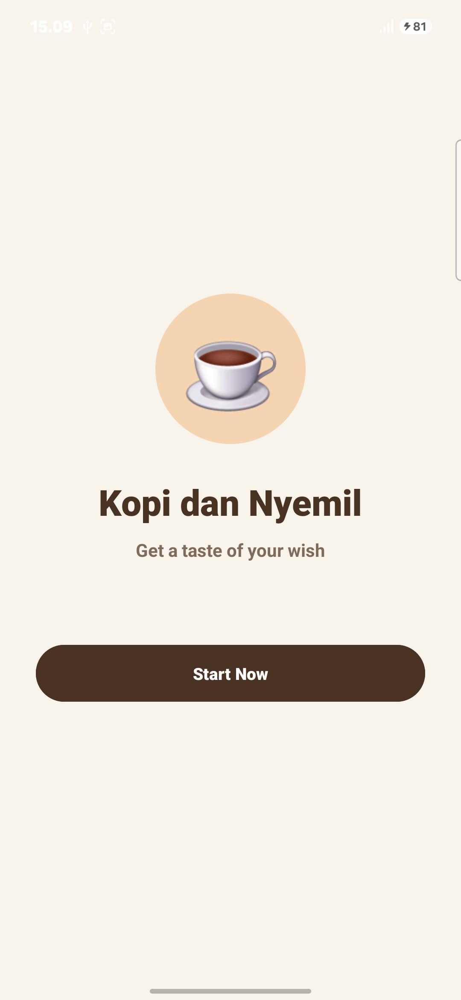

  ### Sign Up
  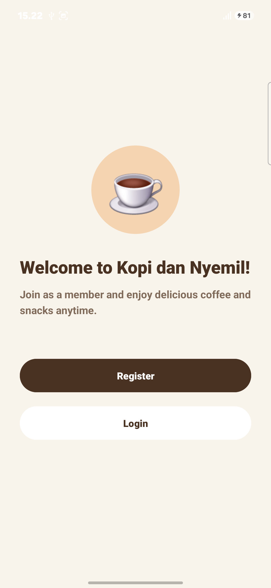

  ### Login
  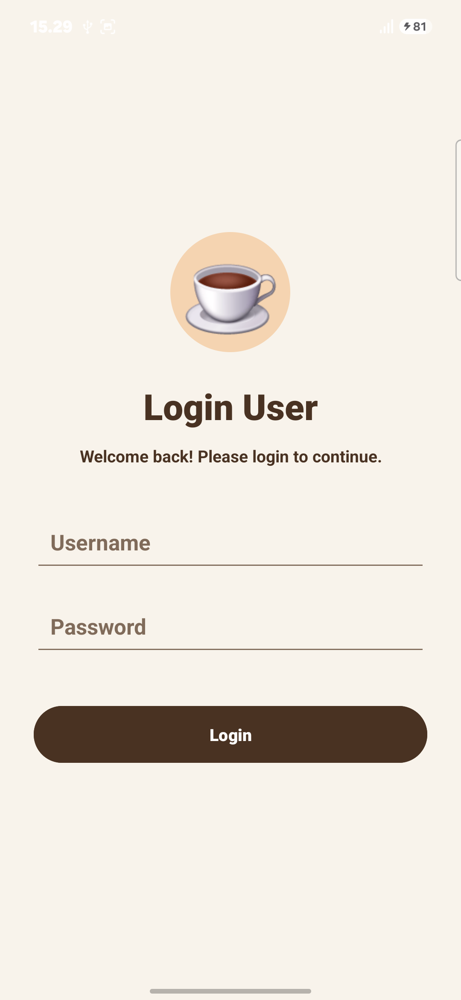

  ### Register
  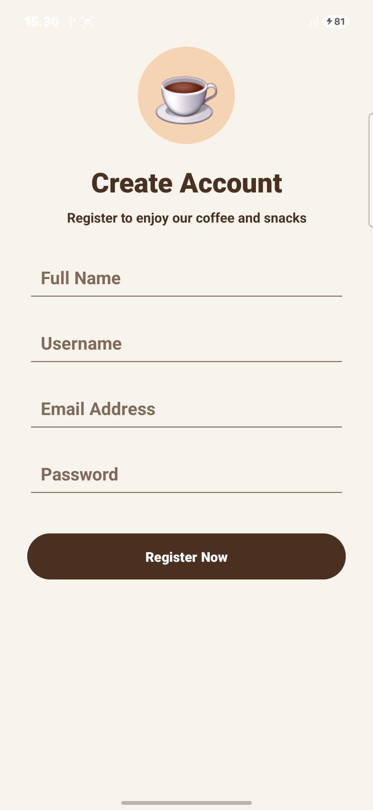

  ### Home
  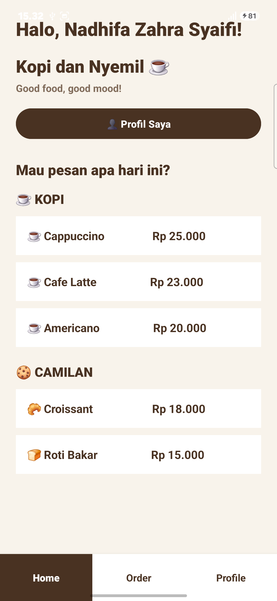

  ### Detail Produk
  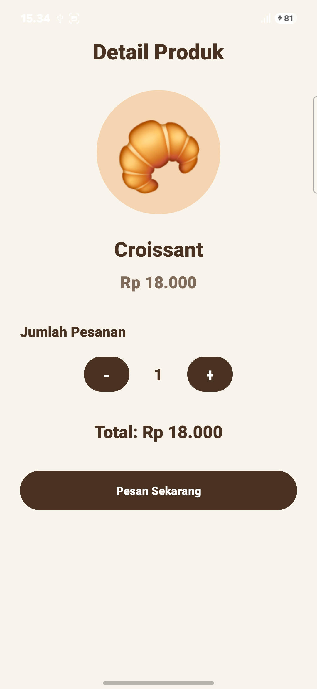

  ### Alamat Pengiriman
  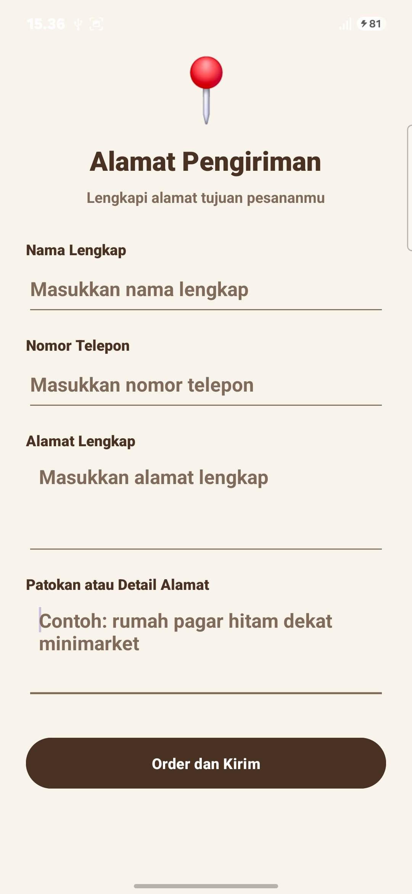

  ### Konfirmasi Pesanan
  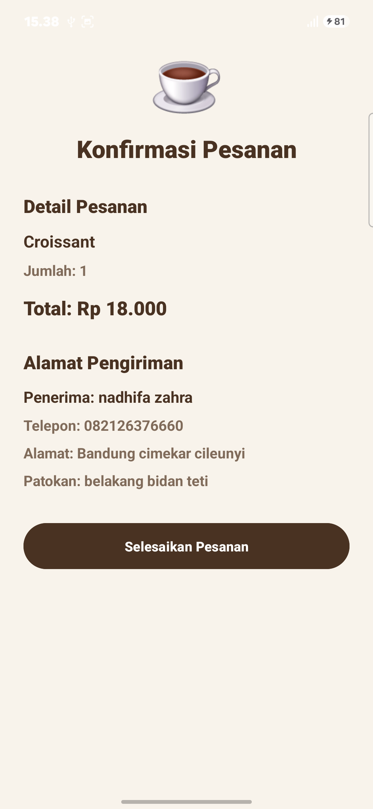

  ### Ucapan Terima Kasih
  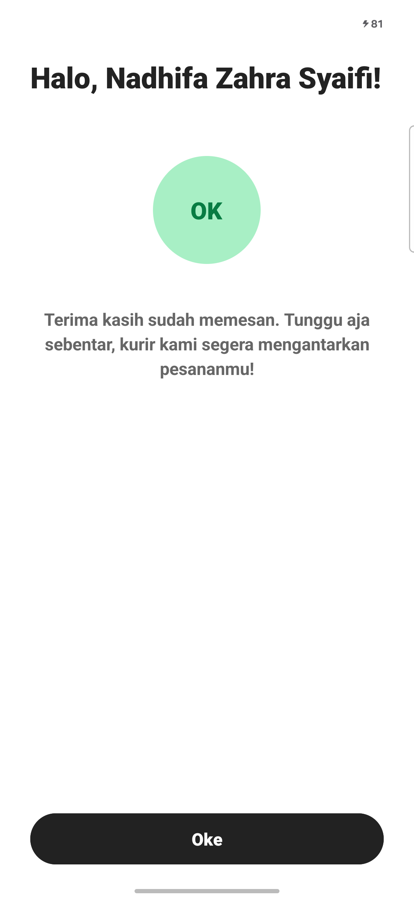

  ### Profile
  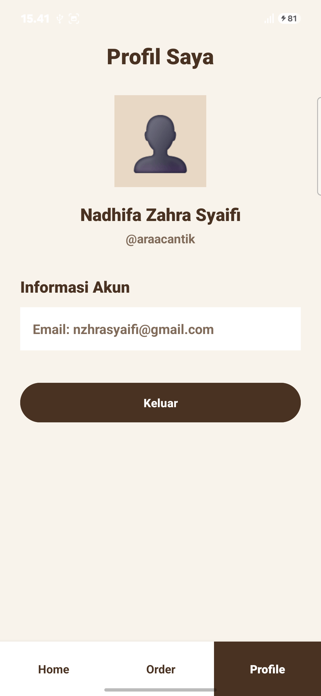

  ### Riwayat Pesanan
  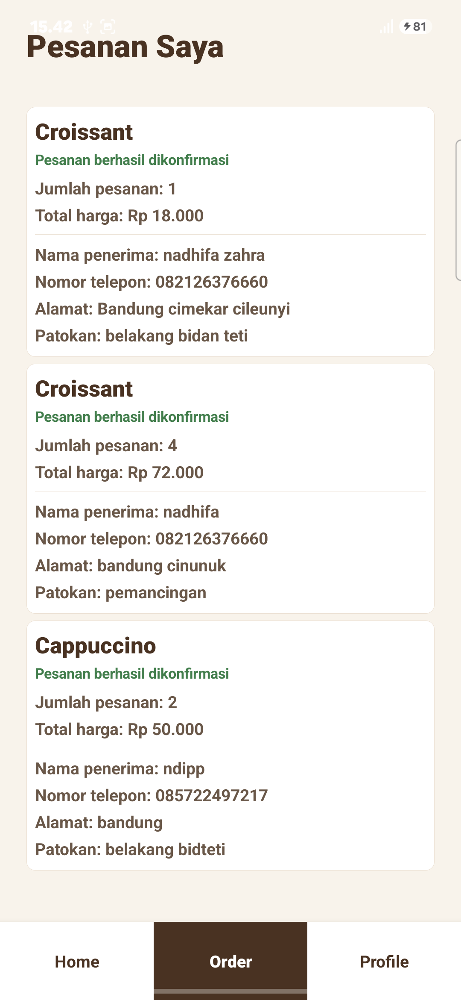
